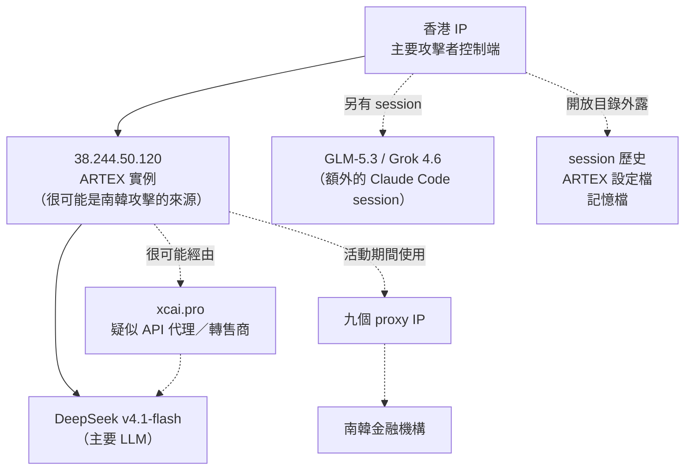

# 攻擊者的伺服器沒上鎖：ARTEX 與南韓金融業入侵事件

威脅情資報告通常從受害端倒推攻擊者的行為。這一篇多了一份攻擊者自己的檔案：2026 年 10 月 7 日，CrowdStrike 發布[這篇分析](https://www.crowdstrike.com/en-us/blog/unknown-threat-actor-uses-artex-to-target-south-korean-finance/)，他們在攻擊者控制的開放目錄裡找到 Claude Code 的 session 歷史、ARTEX 的設定檔，以及 Claude 的記憶檔。

本文談三件事：這起事件發生了什麼、攻擊者拿 AI 做了哪些事，以及防守方能拿走什麼。

## 先把事實排好

| 項目 | 內容 |
|---|---|
| 時間 | 2026 年 9 月下旬到 10 月初 |
| 目標 | 南韓金融機構，結果是資料外洩 |
| 工具 | ARTEX：開源、以 LLM 驅動的 agentic 滲透測試工具，CrowdStrike 稱其由中國開發 |
| 主要 LLM | DeepSeek v4.1-flash；部分 Claude Code session 另用 GLM-5.3（智譜 AI）與 Grok 4.6 |
| 歸因 | 未歸屬任何已命名的組織；CrowdStrike 以中等信心判斷是說中文、以牟利為動機的行為者 |
| 受害範圍 | CrowdStrike 寫明受影響機構數量「尚未確認」 |

歸因那列要多看一眼。「中等信心」的依據只有兩項：用了中國開發的工具，以及觀察到中文提示詞。兩項都稱不上硬證據，所以本文不會把它寫成國家或組織層級的結論。

### 時間線

韓國這邊的日期來自[《京鄉新聞》](https://www.khan.co.kr/en/article/202610042320007)的報導，也就是 CrowdStrike 引用的「業界報導」。

- **7 月 26 日**：ARTEX 在 GitHub 上公開（據京鄉新聞）。
- **9 月 24 日**：ARTEX 發布最新版本（同上）。
- **9 月 27 日至 30 日**：多家南韓金融機構遭入侵（同上，區間是該報導對所列機構的說法）。
- **約 10 月 4 日**：韓國金融委員會召開金融業緊急檢查會議（同上）。
- **10 月 7 日**：CrowdStrike 發布分析。

ARTEX 公開約兩個月後，出現在這波攻擊裡。京鄉說國民銀行的攻擊在新版發布三天後開始，但攻擊者用的是不是新版，兩份文件都沒說。

## 兩台伺服器，一套流程

Claude Code 的 session 紀錄顯示攻擊者用了兩段式架構。圖中實線是 CrowdStrike 的直接描述，虛線是原文用「likely」表達或未明說的部分：

**18899 埠上的 `.claude/CLAUDE.md`，用 HTTP 就能讀。** CrowdStrike 提到的九個 proxy IP 是攻擊者在 ARTEX 相關活動期間用過的，自己這一側卻是開著的。

**CLAUDE.md 裡是一份中文的滲透測試提示詞**，規定 LLM 該怎麼進行滲透測試。ARTEX 的實際能力，CrowdStrike 沒有逐項拆解，本文也不替它補寫。

**DeepSeek 很可能是透過轉售商取得。** CrowdStrike 認為攻擊者「可能」透過 `xcai[.]pro` 存取 DeepSeek，而這個 `xcai[.]pro` 本身也只是「疑似」API 代理或轉售商，兩層都是推測。

## 攻擊者拿 AI 做了哪些事

文章點出的用法不只入侵本身：

1. **執行入侵**：ARTEX 搭配 LLM，在 2026 年 9 月下旬到 10 月初對南韓金融機構展開大量活動。
2. **打聽變現管道**：在 Claude Code session 裡問 Claude，這類韓國外洩資料通常在哪裡販售，並請它協助找韓文的 Telegram 資料販售群組。原文只說「問」，沒說賣了。
3. **請 Claude 寫履歷**：要求它寫一份資安研究員履歷，把這次 ARTEX 相關活動的成果寫成條列。

入侵靠的是 ARTEX 加 DeepSeek，另外兩件事則是在 Claude Code 裡問 Claude。這些紀錄出現在同一批檔案裡，但 CrowdStrike 沒說它們都出自同一個人。它的結論只針對速度：AI 讓牟利型行為者能在短時間內完成多起入侵。

## 兩份報導的落差

CrowdStrike 稱這是針對南韓金融業的活動。據京鄉新聞，南韓主管機關的看法是：AI 在對許多業者隨機探測，防護較弱的才被打穿，並非針對特定對象。

兩者問的層次不同。CrowdStrike 的「針對」指鎖定金融業這個產業，京鄉的「隨機」指手法是廣泛探測，並不衝突。對防守方來說，兩個問法都該問：我是不是被盯上，以及我是不是比鄰居更好打。

受害系統的樣子也支持後一個問法。CrowdStrike 舉了兩例：貸款仲介使用的貸款進度查詢服務，以及銀行員工的行動辦公系統。據京鄉，另有其他機構外洩，並引述資安業者說這類外圍系統缺少主系統那層驗證；確切數量，兩份文件都沒有定論。

### 確認到哪一步，各家說法不一樣

其他媒體的說法，補了三個 CrowdStrike 文章沒有的角度。

- **使用 ARTEX 這件事，韓國官方尚未確認。** 《Korea Times》在 10 月 7 日的解析裡仍用「據報導」。彙整 Yonhap 報導的 [RuntimeWire](https://runtimewire.com/article/south-korea-bank-breaches-artex-ai-probe) 寫到，新韓事件的某台伺服器出現 ARTEX 相關的頁面標題，但實際使用未獲驗證。CrowdStrike 的依據是它拿到的攻擊者基礎設施與 session 紀錄，兩邊證據的層級不同，讀的時候要分開。
- **ARTEX 本身並不稀有。** 據 RuntimeWire，AhnLab 觀察到全球約 600 個 IP 在跑 ARTEX，但這只是託管數，不代表每台都被拿去攻擊。這個數字的出處各家不一，Arirang 的報導說是 S2W。單憑工具痕跡或字串，不足以歸因。
- **受害人數的總計有出入。** WSJ 約 68,000 人，《Korea Times》逾 67,000 人（皆經 RuntimeWire 轉述）。分開看，新韓約 25,000 人、國民 119 人、哈納 89 人。

[高麗大學教授林宗仁](https://www.koreatimes.co.kr/business/banking-finance/20261007/explainer-how-ai-emerged-as-new-threat-in-koreas-bank-hacking-crisis)認為這次「很可能」用了 AI，因為人類駭客要花數週甚至數月；但他也提醒，不要因為發現中文工具就斷定是中國所為。東國大學教授黃錫珍則形容，攻擊者是從窗戶而不是前門進來。

## 這些資訊能轉成什麼防禦動作

**以下是本文的判斷。** CrowdStrike 的文章沒有寫偵測或緩解建議。

| 視角 | 做法 |
|---|---|
| **偵測** | 把 IOC 表的十個 IP，以及內文提到的 `xcai[.]pro`，丟進 SIEM 做回溯查詢；另外看有沒有來源在短時間內出現節奏均勻、規模很大的探測 |
| **防禦** | 優先盤點對外開放的外圍系統，例如仲介入口、行動辦公後台，確認驗證強度不輸主系統；對自動化探測加速率限制與異常行為分析 |
| **治理** | 外圍系統與第三方入口列入風險評級；縮短修補與暴露面收斂的週期，因為對手的節奏變快了 |

**以下回到原文。** CrowdStrike 列出三項 MITRE ATT&CK 技術，全都在資源開發與指揮控制階段：

| 戰術 | 技術 | 文章中的說明 |
|---|---|---|
| Resource Development | T1583.003 取得基礎設施：VPS | 在多個 IP 取得基礎設施，建立指揮控制 |
| Resource Development | T1588.007 取得能力：人工智慧 | 取得並部署 ARTEX |
| Command and Control | T1090 代理 | 使用多個代理 IP |

入侵過程本身怎麼進去、怎麼橫向移動，這份報告沒有覆蓋。拿 ATT&CK 對照自己的偵測覆蓋率時，這三格只是一小塊。

IOC 表只有十個 IP（九個 proxy，加上 `38.244.50[.]120`），沒有域名，也沒有檔案雜湊。`xcai[.]pro` 只出現在內文。本文判斷，代理 IP 通常很快就會換，這份清單比較適合拿來回溯，不適合當長期防線。

## 該克制的地方

CrowdStrike 在 Assessment 之前列了一名疑似攻擊者的個人資料，包含姓名、電話、Telegram 帳號、年齡、學歷與居住地，來自履歷請求的提示詞。同一個 Telegram 帳號也出現在其他 session。

CrowdStrike 認為這些資料「很可能」屬於這次活動的行為者，但也寫明，現有資訊無法確定關聯。把一個尚未確認的連結變成一個具體的人，風險落在被指認的人身上，而防守方要做的事用不到這些資料，所以本文不轉載。

後續的電視新聞已經出現相反的做法：有報導把這條線索直接寫進標題，變成對特定年齡與國籍之嫌疑人的指稱。CrowdStrike 原文用的是「很可能」加上「無法確定」，標題裡這兩個限定詞都不見了。

## 容易想歪的地方

**「這是某國家的行動」。** 文章的歸因停在「可能說中文、可能為了錢」，並明說未歸屬任何組織。工具由哪裡開發，也不等於使用者是誰。

**「這是全新的攻擊手法」。** 本文判斷這份報告談的主要是速度。CrowdStrike 的說法是對手的 tradecraft 持續演進，並預期對手會繼續試驗 AI 以提升作業節奏與能力；它沒有說出現了新的攻擊技術。

**「封鎖一家模型的帳號就夠了」。** 本文判斷這行不通：攻擊者用了 DeepSeek 為主，其他 session 又補用 GLM 與 Grok，若又經轉售商取用，單點封鎖的效果有限。

## 帶走的問題

1. 你的外圍系統，和那個被打穿的貸款查詢服務相比，驗證強度差多少？
2. 如果對手的探測速度提高一個量級，你的偵測與修補週期撐得住嗎？
3. （本文延伸，原文未提）你能不能從自己的對外連線裡，看出有人在使用沒經過核准的 LLM API？

## 來源

- CrowdStrike，〈[Unknown Threat Actor Uses AI-Driven ARTEX to Target South Korean Finance](https://www.crowdstrike.com/en-us/blog/unknown-threat-actor-uses-artex-to-target-south-korean-finance/)〉，2026-10-07。第一手分析，也是本文事實骨架（IP、基礎設施、模型、ATT&CK）的來源。
- Kim Sang-Beom，〈[The Korean financial sector was breached by a two-month-old Chinese AI](https://www.khan.co.kr/en/article/202610042320007)〉，《京鄉新聞》，2026-10-04 發布、10-06 更新。ARTEX 發布日、時間線與主管機關看法出自此文，屬二手媒體來源；CrowdStrike 文章的註腳 1 指向這篇。
- 〈[EXPLAINER How AI emerged as new threat in Korea's bank hacking crisis](https://www.koreatimes.co.kr/business/banking-finance/20261007/explainer-how-ai-emerged-as-new-threat-in-koreas-bank-hacking-crisis)〉，《Korea Times》，2026-10-07。二手媒體；受害人數與專家評論出自此文。
- 〈[AhnLab finds ARTEX on 600 IPs as police probe South Korean bank breaches](https://runtimewire.com/article/south-korea-bank-breaches-artex-ai-probe)〉，RuntimeWire，2026-10-06。彙整稿，轉述 Yonhap、WSJ、Korea Times 與 AhnLab 的說法；600 個 IP 與使用未確認的描述出自此文，屬二手之二手來源。
- 〈[AI-powered hacking targets Korean banks](https://www.youtube.com/watch?v=j380lPqoGl8)〉，Arirang News（YouTube），2026-10-08。電視新聞；本文用它說明媒體如何放大個資線索。
