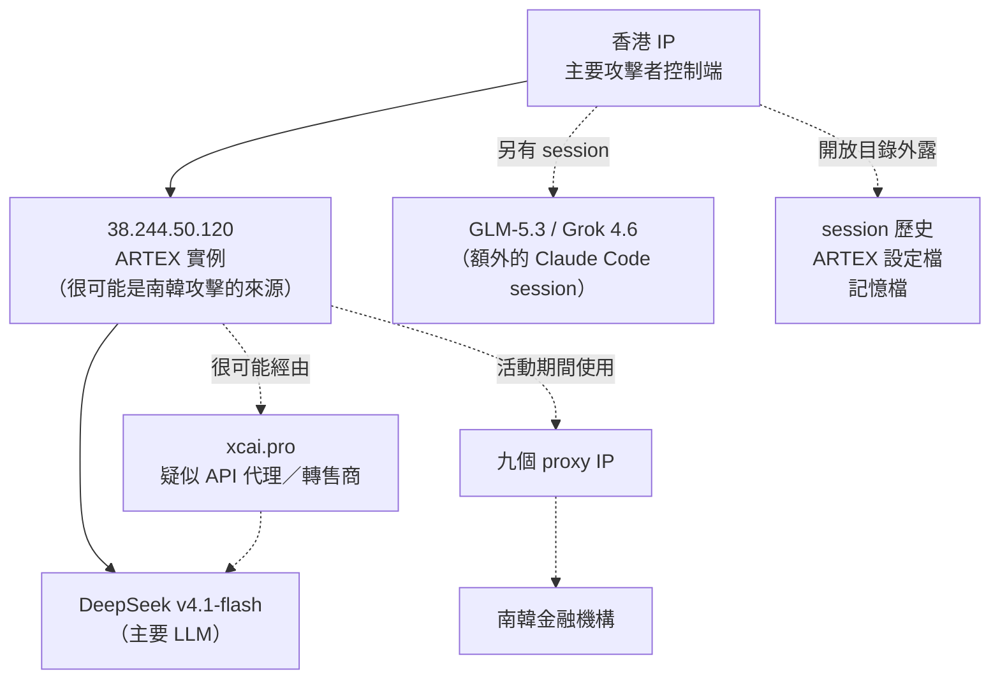

# 駭客的伺服器沒上鎖：ARTEX 入侵南韓金融業事件

一般的資安報告，是從受害者那邊倒推：駭客大概做了什麼。這一篇不太一樣，資安公司 CrowdStrike 直接看到了駭客自己的檔案。

2026 年 10 月 7 日，CrowdStrike 發布[這篇分析](https://www.crowdstrike.com/en-us/blog/unknown-threat-actor-uses-artex-to-target-south-korean-finance/)。他們在駭客控制的伺服器上，找到幾個沒設防、誰都能點開的資料夾。裡面有三樣東西：駭客用 AI 寫程式工具 Claude Code 的對話紀錄、一套叫 ARTEX 的工具的設定檔，還有 Claude 的記憶檔。

這篇導讀想講清楚三件事：這起事件發生了什麼、駭客拿 AI 做了哪些事，還有我們能從中學到什麼。

## 先把事實排好

| 項目 | 內容 |
|---|---|
| 時間 | 2026 年 9 月下旬到 10 月初 |
| 目標 | 南韓的金融機構，客戶資料外洩 |
| 工具 | ARTEX：公開原始碼、由 AI 驅動的滲透測試工具（原本用途是模擬駭客找系統弱點）。CrowdStrike 說它由中國開發 |
| 用到的 AI 模型 | 主力是 DeepSeek v4.1-flash；部分對話另外用 GLM-5.3（智譜 AI）和 Grok 4.6 |
| 是誰幹的 | 不確定。沒有對上任何已知的駭客組織；CrowdStrike 有中等把握，認為是說中文、為了賺錢的人 |
| 受害範圍 | CrowdStrike 寫明，受影響的機構有幾家，「尚未確認」 |

「是誰幹的」那一列要多看一眼。所謂中等把握，依據只有兩項：用的是中國開發的工具，以及看到中文的指令。這兩項都算不上鐵證，所以本文不會把它寫成「某國家」或「某組織」幹的。

### 時間線

韓國這邊的日期，出自[《京鄉新聞》](https://www.khan.co.kr/en/article/202610042320007)的報導，也就是 CrowdStrike 文章裡引用的「業界報導」。

- **7 月 26 日**：ARTEX 在 GitHub 上公開（據京鄉新聞）。
- **9 月 24 日**：ARTEX 推出最新版本（同上）。
- **9 月 27 日至 30 日**：多家南韓金融機構被入侵（同上，這是該報導對所列機構的說法）。
- **約 10 月 4 日**：韓國金融委員會召開金融業緊急檢查會議（同上）。
- **10 月 7 日**：CrowdStrike 發布分析。

ARTEX 公開大約兩個月後，就出現在這波攻擊裡。京鄉說，國民銀行的攻擊在新版推出三天後開始。但駭客用的到底是不是新版，兩份文件都沒說。

## 兩台伺服器，一套流程

從 Claude Code 的對話紀錄看得出來，駭客用了兩台伺服器分工。下面這張圖，實線是 CrowdStrike 直接寫出來的，虛線是原文用「很可能」帶過，或沒有明講的部分：

有三個細節值得一提。

**駭客自己的門沒關。** 其中一台伺服器的 18899 埠上，有個給 AI 的工作指示檔 `CLAUDE.md`，用瀏覽器就能直接打開。駭客在這次活動裡用了九個代理 IP（轉接用的跳板），自己的伺服器卻開著沒鎖。

**那份指示檔寫的是一套中文的滲透測試做法**，告訴 AI 該怎麼一步步找弱點。至於 ARTEX 實際能做到什麼，CrowdStrike 沒有逐項拆解，本文也不替它補。

**DeepSeek 很可能是透過中間商拿到的。** CrowdStrike 認為，駭客「可能」是透過 `xcai[.]pro` 這個網站使用 DeepSeek。而 `xcai[.]pro` 是不是中間商，CrowdStrike 也只說「疑似」。這是兩層的推測，不是確定的事。

## 攻擊者拿 AI 做了哪些事

文章點出的用法，不只是入侵本身：

1. **執行入侵**：用 ARTEX 搭配 AI 模型，在 2026 年 9 月下旬到 10 月初，對南韓金融機構展開大量活動。
2. **打聽怎麼變現**：在 Claude Code 裡問 Claude，這類韓國外洩資料通常在哪裡賣，還請它幫忙找韓文的 Telegram 資料買賣群組。原文只說他「問」，沒說他真的賣了。
3. **請 Claude 寫履歷**：叫它寫一份資安研究員的履歷，把這次 ARTEX 相關活動的成果列成條目。

入侵靠的是 ARTEX 加 DeepSeek，另外兩件事是在 Claude Code 裡問 Claude。這些紀錄出現在同一批檔案裡，但 CrowdStrike 沒說它們都出自同一個人。它下的結論只針對速度：AI 讓一個為了賺錢的人，能在短時間內完成多起入侵。

## 兩份報導的落差

CrowdStrike 說，這是衝著南韓金融業來的活動。據京鄉新聞，南韓主管機關的看法是：AI 在到處亂試，哪家防護弱就從哪家打進去，並不是鎖定特定對象。

這兩個說法談的是不同層次，並不衝突。CrowdStrike 的「針對」，指的是鎖定金融業這個產業；京鄉的「隨機」，指的是手法是廣撒網探測。對防守的人來說，兩個問題都該問：我是不是被盯上了？我是不是比隔壁家更好打？

被打穿的系統，也比較支持後面那個問法。CrowdStrike 舉了兩例：貸款仲介用的貸款進度查詢服務，還有銀行員工的行動辦公系統。據京鄉報導，還有其他機構外洩，並引述資安業者的說法：這類外圍系統，缺少主系統那一層驗證。到底有幾家受害，兩份文件都沒有定論。

### 確認到哪一步，各家說法不一樣

其他媒體的報導，補了三個 CrowdStrike 文章裡沒有的角度。

- **韓國官方還沒確認真的用了 ARTEX。** 《Korea Times》在 10 月 7 日的解析裡，用的仍是「據報導」。彙整 Yonhap 報導的 [RuntimeWire](https://runtimewire.com/article/south-korea-bank-breaches-artex-ai-probe) 提到，新韓事件中的某台伺服器，出現了 ARTEX 相關的網頁標題，但實際有沒有用，沒有得到驗證。CrowdStrike 的依據，是它拿到的駭客伺服器與對話紀錄。兩邊的證據強度不一樣，讀的時候要分開看。
- **架著 ARTEX 的人，不只這一個。** 據 RuntimeWire，AhnLab 發現全球約有 600 個 IP 在跑 ARTEX，但這只是「有人架著它」的數字，不代表每台都拿去攻擊。這個數字是誰發現的，各家說法不一，Arirang 的報導說是 S2W。光是看到這個工具的痕跡或字串，還不足以指認是誰幹的。
- **受害人數的總計對不上。** WSJ 說約 68,000 人，《Korea Times》說超過 67,000 人（都是經 RuntimeWire 轉述）。拆開來看：新韓約 25,000 人、國民 119 人、哈納 89 人。

[高麗大學教授林宗仁](https://www.koreatimes.co.kr/business/banking-finance/20261007/explainer-how-ai-emerged-as-new-threat-in-koreas-bank-hacking-crisis)認為，這次「很可能」用了 AI，因為人類駭客要做到同樣的事，得花上數週甚至數月。不過他也提醒，不要因為發現是中文工具，就斷定是中國幹的。東國大學教授黃錫珍則形容，攻擊者是從窗戶進來的，不是走前門。

## 防守方可以做什麼

**以下是本文自己的判斷。** CrowdStrike 的文章沒有寫怎麼偵測、怎麼防。

| 面向 | 做法 |
|---|---|
| **偵測** | 把 CrowdStrike 附的十個 IP，還有內文提到的 `xcai[.]pro`，拿去日誌分析系統回頭查一遍；另外留意有沒有來源在短時間內，用很規律的節奏大量試探，人手很難做到那樣 |
| **防禦** | 先清點對外開放的邊緣系統，像是仲介入口、員工行動辦公後台，確認它們的登入驗證不比主系統差；對自動化的試探加上次數限制，並留意不正常的行為 |
| **治理** | 把邊緣系統和合作夥伴的入口，列進風險評估；縮短修補漏洞和收斂暴露面的週期，因為對手的動作變快了 |

**以下回到原文。** CrowdStrike 列出三項 MITRE ATT&CK（資安界常用的攻擊手法分類表）的手法，全都落在「事前準備」和「遠端操控」這兩個階段：

| 階段 | 手法 | 文章中的說明 |
|---|---|---|
| 事前準備 | T1583.003 租用伺服器 | 在多個 IP 取得伺服器，建立遠端操控 |
| 事前準備 | T1588.007 取得 AI 能力 | 取得並部署 ARTEX |
| 遠端操控 | T1090 使用代理 | 使用多個代理 IP |

至於駭客怎麼進得去、進去之後怎麼往別台移動，這份報告沒有涵蓋。拿這張分類表來檢查自己的防護時，這三格只是一小塊。

CrowdStrike 附的「已知惡意 IP 清單」（IOC），只有十個 IP（九個代理，加上 `38.244.50[.]120`），沒有網域，也沒有檔案指紋（雜湊值）。`xcai[.]pro` 只出現在內文。本文判斷，代理 IP 通常很快就換掉，所以這份清單比較適合拿來回頭查紀錄，不適合當成長期的防線。

## 該克制的地方

在結論之前，CrowdStrike 列了一名疑似駭客的個人資料，包含姓名、電話、Telegram 帳號、年齡、學歷和居住地，是從「請 Claude 寫履歷」的那段對話裡讀出來的。同一個 Telegram 帳號，也出現在其他對話中。

CrowdStrike 認為，這些資料「很可能」屬於這次活動的行為者，但也明白寫出：目前的資訊，無法確定兩者的關聯。把一個還沒確認的連結，變成一個具體的人，風險會落在被指認的人身上。而防守方要做的事，根本用不到這些資料，所以本文不轉載。

後續的電視新聞，已經出現相反的做法：有報導把這條線索直接寫進標題，變成指稱特定年齡、特定國籍的嫌疑人。CrowdStrike 原文用的是「很可能」加上「無法確定」，到了標題，這兩個限定詞都不見了。

## 容易想歪的地方

**「這是某個國家的行動。」** 文章的結論只到「可能說中文、可能是為了賺錢」，還明說沒有對上任何組織。工具是哪裡開發的，不代表用的人是誰。

**「這是全新的攻擊手法。」** 本文的判斷是，這份報告談的主要是速度。CrowdStrike 的說法是，對手的手法持續演進，並預期對手會繼續試著用 AI，加快作業節奏、增強能力；它並沒有說出現了新的攻擊技術。

**「封鎖一家 AI 模型的帳號就夠了。」** 本文判斷這行不通：駭客以 DeepSeek 為主，其他對話又補用 GLM 和 Grok，如果又透過中間商取用，只封鎖一個點，效果有限。

## 帶走的問題

1. 你的邊緣系統，和那個被打穿的貸款查詢服務相比，登入驗證的強度差多少？
2. 如果對手試探的速度快了十倍，你的偵測和修補來得及嗎？
3. （本文延伸，原文沒提）你能不能從自己對外的連線紀錄裡，看出有人在用沒經過核准的 AI 服務？

## 來源

- CrowdStrike，〈[Unknown Threat Actor Uses AI-Driven ARTEX to Target South Korean Finance](https://www.crowdstrike.com/en-us/blog/unknown-threat-actor-uses-artex-to-target-south-korean-finance/)〉，2026-10-07。第一手分析，也是本文事實骨架（IP、基礎設施、模型、ATT&CK）的來源。
- Kim Sang-Beom，〈[The Korean financial sector was breached by a two-month-old Chinese AI](https://www.khan.co.kr/en/article/202610042320007)〉，《京鄉新聞》，2026-10-04 發布、10-06 更新。ARTEX 發布日、時間線與主管機關看法出自此文，屬二手媒體來源；CrowdStrike 文章的註腳 1 指向這篇。
- 〈[EXPLAINER How AI emerged as new threat in Korea's bank hacking crisis](https://www.koreatimes.co.kr/business/banking-finance/20261007/explainer-how-ai-emerged-as-new-threat-in-koreas-bank-hacking-crisis)〉，《Korea Times》，2026-10-07。二手媒體；受害人數與專家評論出自此文。
- 〈[AhnLab finds ARTEX on 600 IPs as police probe South Korean bank breaches](https://runtimewire.com/article/south-korea-bank-breaches-artex-ai-probe)〉，RuntimeWire，2026-10-06。彙整稿，轉述 Yonhap、WSJ、Korea Times 與 AhnLab 的說法；600 個 IP 與使用未確認的描述出自此文，屬二手之二手來源。
- 〈[AI-powered hacking targets Korean banks](https://www.youtube.com/watch?v=j380lPqoGl8)〉，Arirang News（YouTube），2026-10-08。電視新聞；本文用它說明媒體如何放大個資線索。
